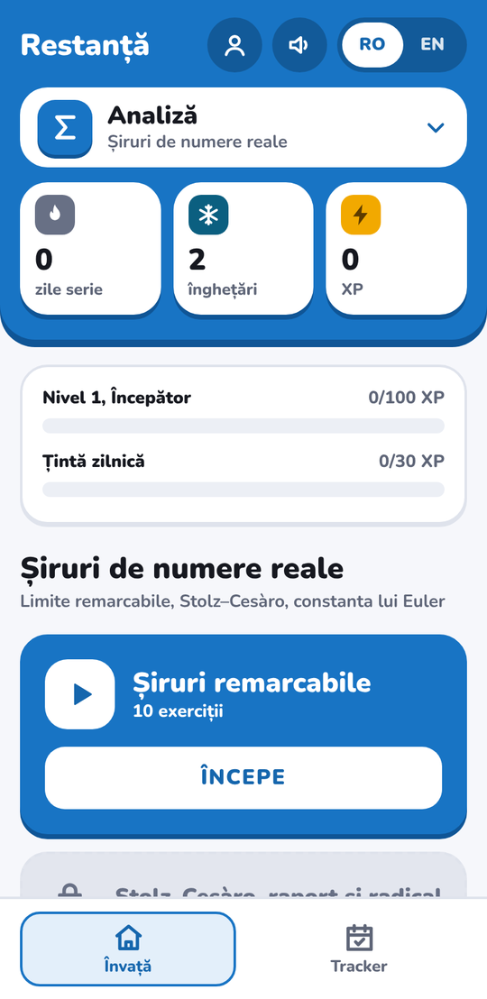
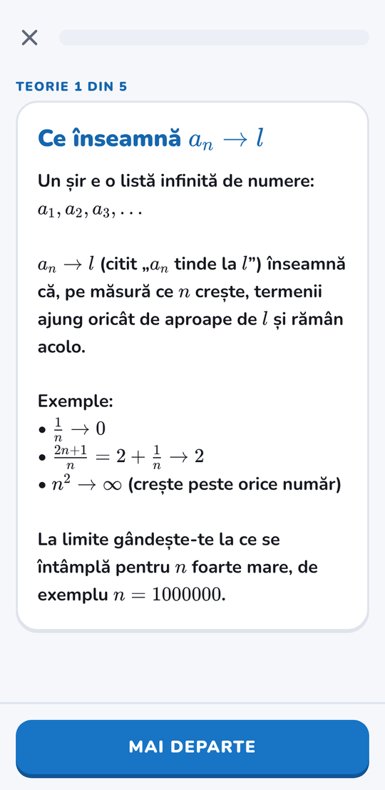

<p align="center"></p>

<p align="center">
  
  
  
  
  
</p>

<p align="center"><b><a href="https://restanta.pages.dev">restanta.pages.dev</a></b></p>

**Restanță** e o aplicație în stil Duolingo pentru materiile din anul I de facultate: **Analiză**, **Algebră** și **Programare în C**. Lecții scurte, serie zilnică, XP și explicație după fiecare răspuns. În română și engleză, cu un singur buton.

<p align="center">
  
  &nbsp;&nbsp;
  
</p>

## Ce face

- **Lecție = teorie, apoi exerciții.** 4–5 carduri de teorie care se pot reciti, apoi 10 exerciții trase la întâmplare dintr-un set mai mare. Un răspuns greșit se pune din nou la final.
- **Exerciții cu numere noi de fiecare dată.** Multe sunt șabloane (`vars`, `where`, `[[expr]]` evaluat cu mathjs), deci nu poți învăța răspunsurile pe de rost.
- **Trei tipuri de exerciții:** alegere multiplă, scrii răspunsul (expresie, număr sau text, verificat matematic: `2(x+1)` = `2x+2`) și rezolvare pas cu pas. Pentru C urmează „scrie și rulează”.
- **Serie, înghețări, XP și tracker.** O zi de serie înseamnă cel puțin o lecție terminată. Fără inimi, ligi sau presiune.
- **Matematică frumoasă** prin KaTeX, **română și engleză** pe fiecare text, instalabilă ca PWA.
- **Progres fără cont.** Îți alegi un cod (fără email) și progresul se sincronizează între dispozitive. Fără cont, rămâne în browser.

## Rulează local

```bash
npm install
npm run dev        # http://localhost:5173
npm test           # verifică tot conținutul, în ambele limbi
npm run build      # tsc + teste + vite build, rezultatul în dist/
```

## Conținut

Câte un fișier JSON pe materie în `src/content/`: unități → lecții → teorie + exerciții.

```json
{"id":"al-1-1","title":{"ro":"Ce este un corp","en":"What is a field"},"pick":10,
 "theory":[{"ro":"Titlu\ntext...","en":"Title\ntext..."}],
 "exercises":[
   {"type":"input","check":"number","skill":"zp","vars":{"n":[4,12],"a":[2,11]},"where":"a < n",
    "prompt":{"ro":"…","en":"…"},"answer":"[[mod(a*a,n)]]","explain":{"ro":"…","en":"…"}}
 ]}
```

`src/logic.test.ts` rulează înainte de fiecare build: forma fișierelor, teorie prezentă, setul de exerciții mai mare decât `pick`, un `skill` și un `explain` la fiecare exercițiu, matematica se randează, fiecare șablon e tras de 40 de ori. Detalii despre reguli și decizii în [`SPEC.md`](SPEC.md).

Exercițiile sunt originale, scrise pe baza temelor din cursuri, fără text sau figuri copiate.

## Publică pe Cloudflare Pages

1. `npm run build`, apoi încarci folderul `dist/` (Workers & Pages → Create → Pages → Upload assets) sau legi repo-ul cu comanda de build `npm run build` și directorul `dist`.
2. Pentru sincronizarea cu cod, creează un **KV namespace** și leagă-l la proiect ca binding cu numele **`KV`** (Settings → Bindings). Funcțiile din `functions/api/` rulează automat.
3. Opțional, secretul `ADMIN_KEY` activează `/api/admin`: listă cu toate codurile și un rezumat (`GET`), respectiv ștergerea unui cod (`DELETE ?code=…`), cu `Authorization: Bearer <ADMIN_KEY>`.
4. Redeploy, ca binding-urile să intre în vigoare.

Fără KV aplicația funcționează la fel, doar fără sincronizare între dispozitive.

> **Atenție:** codul de sincronizare e singura „parolă”, iar coduri scurte se pot ghici (nu există limită de încercări). Alege un cod lung sau adaugă Turnstile / un contor în KV dacă o publici pentru mulți utilizatori.

## Ce urmează

Deciziile și planul sunt în [`SPEC.md`](SPEC.md): puncte, magazin, misiuni zilnice, subiecte slabe, numărătoare inversă la examen, buton de rulare pentru C (picoc în WebAssembly) și varianta Android cu Capacitor.

## Licență

[MIT](LICENSE) pentru cod. Conținutul lecțiilor e scris de autor pentru uz de învățare.
